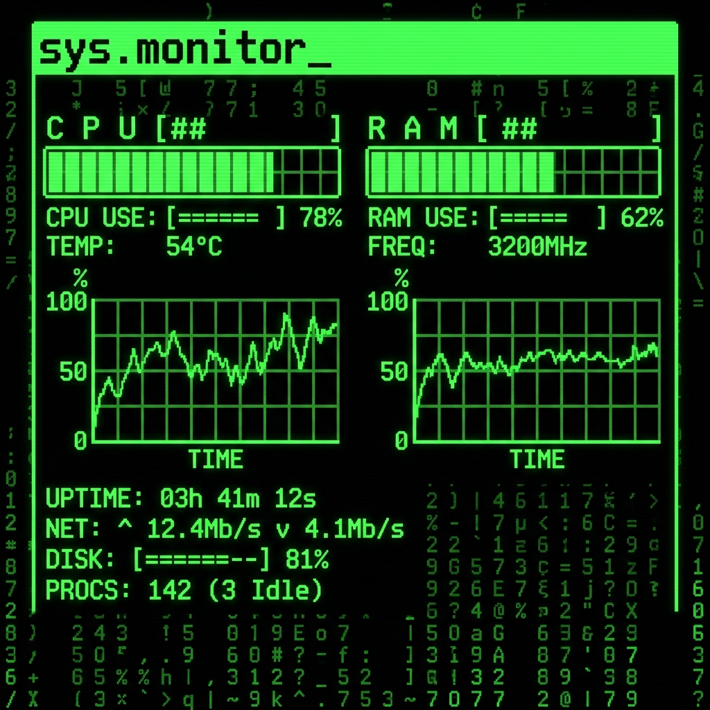
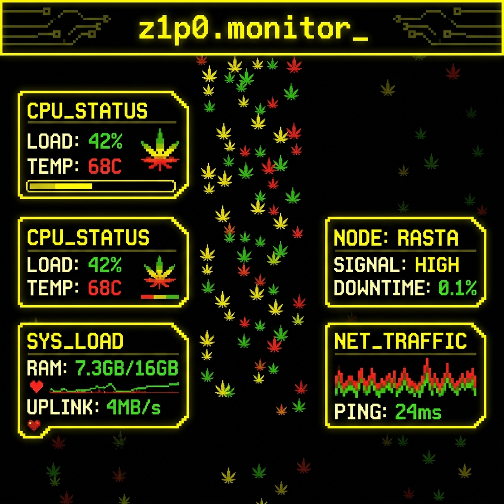

# ⚡ CYD Hardware & Financial Market Monitor (v3.0)


-blue?style=for-the-badge&logo=espressif)


Um **monitor de hardware e terminal de mercado financeiro em tempo real** de código aberto para a placa **ESP32-2432S028R (*Cheap Yellow Display* / CYD 2.8" 320×240)**, controlado **100% pelo PC via USB Serial** através de um painel desktop moderno construído em **Flet (Flutter para Python)**.

<p align="center">
  
  
</p>

---

## 🎯 Por que este projeto existe? (Arquitetura *No-Touch*)

Muitas placas **ESP32-2432S028R (CYD)** sofrem com falhas no controlador resistivo de toque (`XPT2046`) ou leituras fantasmas após algum tempo de uso. Além disso, configurar temas, cores e telas diretamente em uma tela resistiva pequena é pouco prático.

Na **versão 3.0**, toda a dependência de hardware do touch foi **100% removida do firmware** (economizando RAM, CPU e barramentos SPI no ESP32) e **100% do controle foi transferido para o Agente no PC**:
- Troca instantânea de telas (`< 50ms` via fila *event-driven*).
- Seletor de cores **RGB565 / HEX** em tempo real que repinta toda a interface da placa na hora.
- Controle de brilho do display via **PWM (Pino 21)**.
- Upload e conversão automática de papéis de parede (`JPG`, `PNG`, `BMP`, `GIF`) do PC direto para o **Cartão MicroSD** da placa pelo próprio cabo USB.
- **Letreiro Infinito da Bolsa de Valores (*Ticker Tape*)** correndo suavemente no rodapé das telas de hardware enquanto você joga ou trabalha, além de uma **Tela Dedicada ao Mercado Financeiro & Criptomoedas**.

---

## 📍 Estágio Atual do Projeto & Roadmap

O projeto encontra-se atualmente no **Estágio v3.0 (Estável & Pronto para Produção)**. Abaixo está o histórico de evolução e o que está aberto para contribuições da comunidade:

| Fase | Descrição | Status |
| :--- | :--- | :---: |
| **Fase 1** | Telemetria básica de Hardware (CPU, GPU, RAM, Disco, Rede) via USB Serial | ✅ Concluído |
| **Fase 2** | **Arquitetura *No-Touch***: Remoção do `XPT2046`, suporte a Wallpapers `.JPG`/`.BMP`/`.GIF` no SD Card, Color Picker RGB565 e Brilho PWM | ✅ Concluído |
| **Fase 3 (Atual)** | **Painel Desktop em Flet (Flutter)** + **Gráfico Duplo CPU vs RAM** + **Terminal de Mercado Financeiro (`USD`, `EUR`, `BTC`, `ETH`, `SOL`, `BNB`, `XRP`, `IBOV`, `S&P500`)** + **Letreiro Infinito (*Ticker Tape*) a 28 FPS** | ✅ **Concluído (v3.0)** |
| **Fase 4 (Roadmap)** | Alertas visuais/sonoros de preço de Cripto/Dólar no buzzer e LED RGB da CYD | 🚧 Aberto a PRs |
| **Fase 5 (Roadmap)** | Modo sem fio opcional (Envio do payload JSON via **Wi-Fi / UDP / WebSocket**) | 🚧 Aberto a PRs |
| **Fase 6 (Roadmap)** | Suporte a múltiplos perfis de placas (ex: CYD 3.5" `480x320` e ESP32-S3) | 🚧 Aberto a PRs |

---

## 🖥️ As 7 Telas da CYD (320×240)

Todas as telas podem ser alternadas com 1 clique no painel Flet do PC (ou pelo botão físico `BOOT` traseiro da placa):

1. **Tela 0 — `Resumo Gauges` (`SCR_RESUMO`):**
   - Medidores circulares suaves (*Smooth Arc Gauges*) para **CPU %** e **RAM %**, acompanhados de temperatura, clock, uso de GPU, VRAM/Swap, Disco e tráfego de Rede (`DL`/`UL`).
2. **Tela 1 — `Painel CPU + RAM` (`SCR_CPU_RAM` - *Tela Principal*):**
   - Inspirada no visual clássico *terminal cyberpunk* (`sys.monitor_`): barras de progresso segmentadas de **CPU** e **RAM** lado a lado no topo, **2 gráficos de histórico dedicados (`CPU USE %` e `RAM USE %`)** no centro, barra de Uptime/Rede/Disco abaixo e o **Letreiro da Bolsa** correndo no rodapé.
3. **Tela 2 — `Gráfico Duplo CPU vs RAM` (`SCR_CPU_RAM_DUAL`):**
   - Cards de CPU e RAM no topo e um **Gráfico Osciloscópio Grande Unificado** sobrepondo as curvas de **Uso de CPU (%)** e **Uso de RAM (%)** em cores contrastantes em tempo real.
4. **Tela 3 — `GPU Focus` (`SCR_GPU_FOCUS`):**
   - Medidor grande de carga da placa de vídeo, temperatura da GPU, consumo em Watts (`W`), contador de **FPS em jogos** (via RTSS/PresentMon), barra de VRAM e gráfico histórico da GPU.
5. **Tela 4 — `4x Gráficos em Tempo Real` (`SCR_GRAPH`):**
   - Grid 2×2 com gráficos simultâneos para `CPU %`, `RAM %`, `GPU %` e `TEMP °C`.
6. **Tela 5 — `Wallpaper HUD` (`SCR_WALLPAPER`):**
   - Deixa 75% da tela livre para exibir sua arte/foto do Cartão SD (`.jpg`, `.bmp` ou `.gif` animado) com um dock minimalista de CPU, RAM, GPU e Rede + Letreiro da Bolsa na parte inferior.
7. **📈 Tela 6 — `Mercado Financeiro & Bolsa` (`SCR_MARKET`):**
   - Transforma a CYD em um **Terminal Financeiro Bloomberg / B3**:
     - **3 Cards Superiores:** **Dólar Comercial (`USD/BRL`)**, **Euro (`EUR/BRL`)** e **IBOVESPA (`B3`)** com badges coloridos de variação diária (`+` verde / `-` vermelho).
     - **Coluna Esquerda (`CRIPTOMOEDAS 24H`):** Cotação ao vivo em Dólar e variação 24h das 5 principais criptos: **Bitcoin (`BTC`)**, **Ethereum (`ETH`)**, **Solana (`SOL`)**, **BNB (`BNB`)** e **Ripple (`XRP`)**.
     - **Coluna Direita (`BITCOIN 24H`):** Preço do Bitcoin em **USD (`$`)**, valor convertido em **Reais (`R$ mil`)** e **Gráfico Sparkline das últimas 24h** (48 candles de 30m da Binance).

### 📟 Letreiro Infinito da Bolsa (*Ticker Tape*) nas Telas de Hardware
Em todas as telas (0 a 6), a faixa inferior (`y = 222..239`, 18px de altura) utiliza um buffer em memória RAM (`TFT_eSprite` de `320×18`) atualizado a **~28 FPS** para deslizar continuamente as cotações de **Dólar, Euro, Bitcoin ($ e R$), Ethereum, Solana, BNB, XRP, IBOVESPA e S&P 500** sem causar *flicker* nas métricas de hardware. Você pode ativar ou ocultar o letreiro a qualquer momento pelo painel do PC.

---

## 📂 Estrutura do Repositório

O projeto foi organizado de forma modular para facilitar o entendimento e a contribuição da comunidade:

```text
minimal-monitor/
├── firmware/                        # Firmware C++ / Arduino para o ESP32-2432S028R (CYD)
│   ├── minimal_monitor/
│   │   ├── minimal_monitor.ino      # Loop principal, renderizador TFT_eSPI (7 telas + Ticker Sprite) e parser JSON
│   │   └── ui_theme.h               # Constantes das 7 telas (SCR_0..SCR_6), dimensões e paleta RGB565
│   └── User_Setup.h                 # Mapeamento de pinos SPI do display da placa CYD (ST7789 / ILI9341)
│
├── agent/                           # Agente Desktop (PC) e Painel de Controle Total em Flet (Flutter)
│   ├── agent.py                     # Coletor Hardware + Coletor Mercado Financeiro + GUI Flet + Uploader SD
│   ├── requirements.txt             # Dependências Python do projeto
│   ├── ui_config.example.json       # Modelo do arquivo de configuração persistida pelo Agente
│   ├── agent.spec                   # Especificação PyInstaller / Flet Pack
│   ├── dist/
│   │   └── CYD-Hardware-Monitor.exe # Executável standalone pronto para Windows (sem precisar instalar Python)
│   ├── 99-mike-cyd.rules            # Regra udev para porta USB Serial no Linux
│   └── mike-agent.service           # Serviço systemd opcional para Linux
│
├── docs/                            # Documentação Técnica e Arquitetura
│   └── ARCHITECTURE.md              # Especificação completa do Protocolo Serial JSON v3.0 e pinagem da CYD
│
├── imagens-referencia/              # Wallpapers de exemplo (JPG/GIF) prontos para enviar ao Cartão SD
├── preview/                         # Previews gerados dos componentes e telas
├── tools/                           # Utilitários de verificação e simulação offline das telas
├── .github/ISSUE_TEMPLATE/          # Templates padronizados para relato de Bugs e sugestões de Features
├── CONTRIBUTING.md                  # Guia rápido para desenvolvedores contribuírem com novas telas/sensores
├── LICENSE                          # Licença MIT Open Source
├── platformio.ini                   # Configuração de compilação e bibliotecas do PlatformIO
└── README.md                        # Documentação principal do projeto
```

---

## 🚀 Como Usar e Instalar

### Passo 1: Preparando o Computador (Leitura de Sensores)
1. Para obter leituras precisas de temperatura de CPU/GPU, clock e consumo no Windows, baixe o **[LibreHardwareMonitor](https://github.com/LibreHardwareMonitor/LibreHardwareMonitor/releases)**.
2. Abra o LibreHardwareMonitor, clique em **`Options` -> `Remote Web Server` -> `Run`** (porta padrão `8085`).
   - *Nota:* Caso o LibreHardwareMonitor não esteja aberto, o Agente continuará funcionando normalmente usando fallbacks nativos (`psutil`, `WMI`, `nvidia-smi`).
   - As cotações do **Mercado Financeiro & Cripto** são coletadas automaticamente de APIs públicas gratuitas (*AwesomeAPI*, *Binance Public API* e *Yahoo Finance*), **sem exigir nenhuma chave de API (API Key)**.
3. Certifique-se de ter o driver USB **CH340** instalado caso o Windows não reconheça a porta COM da placa CYD.

---

### Passo 2: Executando o Painel de Controle no PC (Flet / Flutter)

#### Opção A: Usando o Executável Pronto (Windows)
Basta abrir diretamente o executável empacotado:
```powershell
.\agent\dist\CYD-Hardware-Monitor.exe
```

#### Opção B: Rodando pelo Código-Fonte Python
1. Crie e ative um ambiente virtual Python (`.venv`) na raiz do repositório:
   ```powershell
   python -m venv .venv
   .\.venv\Scripts\pip install -r agent\requirements.txt
   ```
2. Inicie o Agente com a interface Flet:
   ```powershell
   .\.venv\Scripts\python agent\agent.py
   ```
   - Para testar a saída JSON no terminal sem abrir a interface gráfica:
     ```powershell
     .\.venv\Scripts\python agent\agent.py --stdout --once
     ```

---

### Passo 3: Gravando o Firmware na Placa CYD (PlatformIO)
1. Instale o **[VS Code](https://code.visualstudio.com/)** com a extensão **[PlatformIO IDE](https://platformio.org/)**.
2. Insira um **Cartão MicroSD formatado em FAT32** no slot da placa CYD caso deseje armazenar e exibir papéis de parede `.jpg`, `.bmp` ou `.gif`.
3. Conecte a placa CYD ao PC via cabo Micro-USB / USB-C e compile/grave o firmware:
   ```powershell
   pio run -e cyd -t upload
   ```
   *(O PlatformIO baixará automaticamente as bibliotecas `TFT_eSPI`, `ArduinoJson`, `TJpg_Decoder` e `AnimatedGIF` configuradas no [`platformio.ini`](platformio.ini)).*

---

## 📡 Resumo do Protocolo Serial JSON (v3.0)

O Agente Python comunica-se com o ESP32 a `115200 bps` enviando linhas JSON terminadas por `\n` (`newline-delimited JSON`):

```json
{
  "sys": {
    "cpu": 24.5, "cput": 54.0, "cpuf": 4200, "cores": 12,
    "ram": 62.1, "ramu": 9.9, "ramt": 16.0, "swap": 2.0,
    "gpu": 45.0, "gput": 61.0, "gpuw": 115.0, "vram": 50.0, "gpuname": "RADEON",
    "dsk": 55.6, "dskf": 412.3, "rx": 1.25, "tx": 0.18,
    "hh": 16, "mm": 30, "up": 86400, "host": "MEU-PC"
  },
  "mkt": {
    "usd": 5.06, "usdc": -0.69,
    "eur": 5.70, "eurc": -0.20,
    "ibov": 205430, "ibovc": -0.52,
    "sp500": 7659, "sp500c": -0.77,
    "btc": 81530, "btcc": 0.50, "btc_brl": 412786,
    "eth": 2417.0, "ethc": 0.54,
    "sol": 103.97, "solc": 1.07,
    "bnb": 715.87, "bnbc": -0.56,
    "xrp": 1.30, "xrpc": 0.54,
    "btch": [42, 48, 51, 60, 75, 82, 95, 100]
  },
  "ui": {
    "screen": 1,
    "color": "0x07E0",
    "bg": "megadeth-rust-in-p.jpg",
    "brt": 220,
    "ticker": true
  }
}
```
> 📖 Para detalhes completos sobre o protocolo de upload de imagens via Serial (Chunked Base64) e pinagem de hardware, consulte [`docs/ARCHITECTURE.md`](docs/ARCHITECTURE.md).

---

## 🤝 Como Contribuir

Este é um projeto **Open Source** e contribuições da comunidade são muito bem-vindas! Seja criando novas telas em `TFT_eSPI`, adicionando novos indicadores financeiros, integrando novos sensores ou melhorando o painel em Flet:

1. Leia o nosso **[Guia de Contribuição (`CONTRIBUTING.md`)](CONTRIBUTING.md)**.
2. Consulte a **[Arquitetura Técnica (`docs/ARCHITECTURE.md`)](docs/ARCHITECTURE.md)**.
3. Faça um *Fork* do repositório, crie sua *branch* (`git checkout -b feat/minha-nova-tela`) e abra um **Pull Request**!

---

## 📄 Licença

Distribuído sob a licença **MIT**. Veja o arquivo [`LICENSE`](LICENSE) para mais informações.

---
*Projeto arquitetado e escalado por **Matheus Augusto** & comunidade Open Source.*

---

## 📡 Resumo do Protocolo Serial JSON (v3.0)

O Agente Python comunica-se com o ESP32 a `115200 bps` enviando linhas JSON terminadas por `\n` (`newline-delimited JSON`):

```json
{
  "sys": {
    "cpu": 24.5, "cput": 54.0, "cpuf": 4200, "cores": 12,
    "ram": 62.1, "ramu": 9.9, "ramt": 16.0, "swap": 2.0,
    "gpu": 45.0, "gput": 61.0, "gpuw": 115.0, "vram": 50.0, "gpuname": "RADEON",
    "dsk": 55.6, "dskf": 412.3, "rx": 1.25, "tx": 0.18,
    "hh": 16, "mm": 30, "up": 86400, "host": "MEU-PC"
  },
  "mkt": {
    "usd": 5.06, "usdc": -0.69,
    "eur": 5.70, "eurc": -0.20,
    "ibov": 205430, "ibovc": -0.52,
    "sp500": 7659, "sp500c": -0.77,
    "btc": 81530, "btcc": 0.50, "btc_brl": 412786,
    "eth": 2417.0, "ethc": 0.54,
    "sol": 103.97, "solc": 1.07,
    "bnb": 715.87, "bnbc": -0.56,
    "xrp": 1.30, "xrpc": 0.54,
    "btch": [42, 48, 51, 60, 75, 82, 95, 100]
  },
  "ui": {
    "screen": 1,
    "color": "0x07E0",
    "bg": "megadeth-rust-in-p.jpg",
    "brt": 220,
    "ticker": true
  }
}
```
> 📖 Para detalhes completos sobre o protocolo de upload de imagens via Serial (Chunked Base64) e pinagem de hardware, consulte [`docs/ARCHITECTURE.md`](docs/ARCHITECTURE.md).

---

## 🤝 Como Contribuir

Este é um projeto **Open Source** e contribuições da comunidade são muito bem-vindas! Seja criando novas telas em `TFT_eSPI`, adicionando novos indicadores financeiros, integrando novos sensores ou melhorando o painel em Flet:

1. Leia o nosso **[Guia de Contribuição (`CONTRIBUTING.md`)](CONTRIBUTING.md)**.
2. Consulte a **[Arquitetura Técnica (`docs/ARCHITECTURE.md`)](docs/ARCHITECTURE.md)**.
3. Faça um *Fork* do repositório, crie sua *branch* (`git checkout -b feat/minha-nova-tela`) e abra um **Pull Request**!

---

## 📄 Licença

Distribuído sob a licença **MIT**. Veja o arquivo [`LICENSE`](LICENSE) para mais informações.

---
*Projeto arquitetado e escalado por **Matheus Augusto** & comunidade Open Source.*

