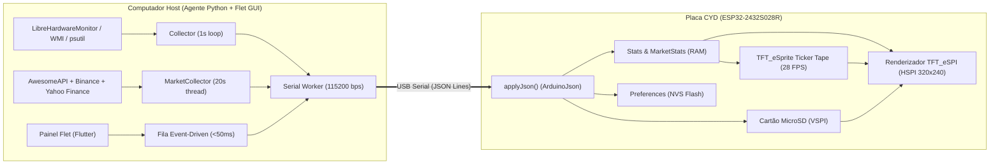

# 🏗️ Arquitetura Técnica & Especificação do Protocolo (v3.0)

Este documento descreve a arquitetura interna do **CYD Hardware & Financial Market Monitor**, o mapeamento de pinos da placa **ESP32-2432S028R** e o protocolo de comunicação serial JSON entre o Agente Desktop (Flet) e o ESP32.

---

## 1. Visão Geral da Arquitetura



---

## 2. Mapeamento de Pinos (ESP32-2432S028R "CYD")

| Periférico | Barramento | Pinos GPIO | Observações |
| :--- | :---: | :--- | :--- |
| **Display TFT (ST7789 / ILI9341)** | `HSPI` | `MOSI=13`, `SCLK=14`, `CS=15`, `DC=2`, `RST=12` | Resolução `320x240` (Landscape `Rotation 1`) |
| **Backlight (Brilho)** | `PWM (LEDC)` | `GPIO 21` | Controle contínuo `5..255` (5 kHz, 8-bit) |
| **Cartão MicroSD** | `VSPI` | `SCK=18`, `MISO=19`, `MOSI=23`, `CS=5` | Suporta `.jpg`, `.jpeg`, `.bmp` e `.gif` |
| **LED RGB Traseiro** | `Digital` | `R=4`, `G=16`, `B=17` | Lógica invertida (`LOW` = aceso). Indica status térmico |
| **Botão Físico Traseiro** | `Digital` | `GPIO 0 (BOOT)` | Alterna entre as 7 telas manualmente se desejado |
| **Touch (`XPT2046`)** | *Desativado* | — | **100% removido** na arquitetura *No-Touch* |

---

## 3. Protocolo Serial JSON (`115200 bps`, `8N1`)

Cada mensagem enviada pelo PC ao ESP32 é um objeto JSON compacto em uma única linha terminada por `\n`.

### 3.1. Pacote Completo de Telemetria + Mercado + UI
```json
{
  "sys": {
    "cpu": 18.5,
    "cput": 52.0,
    "cpuf": 3800,
    "cores": 12,
    "ram": 68.4,
    "ramu": 10.9,
    "ramt": 16.0,
    "swap": 1.2,
    "gpu": 12.0,
    "gput": 49.0,
    "gpuw": 35.0,
    "vram": 24.5,
    "vramu": 2.0,
    "vramt": 8.0,
    "gpuname": "RADEON",
    "dsk": 55.0,
    "dskf": 412.0,
    "rx": 0.45,
    "tx": 0.08,
    "hh": 17,
    "mm": 5,
    "up": 162400,
    "host": "MEU-PC"
  },
  "mkt": {
    "usd": 5.063, "usdc": -0.69,
    "eur": 5.704, "eurc": -0.20,
    "ibov": 205430, "ibovc": -0.52,
    "sp500": 7659, "sp500c": -0.77,
    "btc": 81530, "btcc": 0.50, "btc_brl": 412786,
    "eth": 2417.0, "ethc": 0.54,
    "sol": 103.97, "solc": 1.07,
    "bnb": 715.87, "bnbc": -0.56,
    "xrp": 1.30, "xrpc": 0.54,
    "btch": [42, 48, 51, 60, 75, 82, 95, 100]
  },
  "ui": {
    "screen": 1,
    "color": "0x07E0",
    "bg": "cyberpunk.jpg",
    "brt": 220,
    "ticker": true
  }
}
```

### 3.2. Pacote Rápido Orientado a Eventos (*Event-Driven UI*)
Quando o usuário clica em uma tela, muda a cor ou move o slider de brilho no Flet, o Agente envia imediatamente apenas o bloco `ui` (sem aguardar o ciclo de 1s):
```json
{"ui":{"screen":6,"color":"0x07FF","bg":"none","brt":200,"ticker":true}}
```

### 3.3. Upload de Imagens do PC para o Cartão SD via Serial
O Agente redimensiona qualquer imagem do PC para `320x240` JPEG Baseline e envia em blocos de `512 bytes` codificados em Base64:
1. **Início do arquivo:** `{"file_name":"/wallpaper.jpg","file_mode":"w"}` -> ESP32 responde `ACK_START`
2. **Blocos de dados:** `{"file_name":"/wallpaper.jpg","file_mode":"a","file_data":"<BASE64>"}` -> ESP32 responde `ACK_CHUNK`
3. **Fim do arquivo:** `{"file_name":"/wallpaper.jpg","file_mode":"eof"}` -> ESP32 grava no NVS, aplica na tela e responde `ACK_EOF` + `SD_FILES:[...]`

